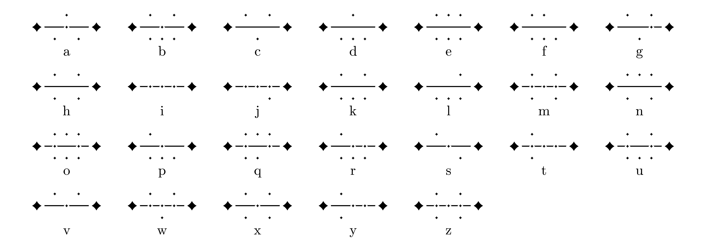

# astronymic
a little python script to randomly generate astronymics from your given words. inspired by @the_alchemy_book but i reinvented the letters so it is easier to code. the new alphabet is below.

the circle shows the starting node. a single node can have up to three letters starting out of it, in that case they are ordered clockwise. if confused what is the start/end, the last letter from a single node will be the one that has the ending node with new letters starting out of it. if it happens that it is the last letter-spawning node, just reroll the seed.
